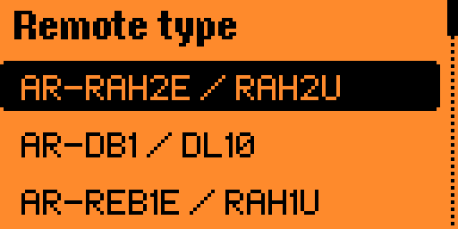
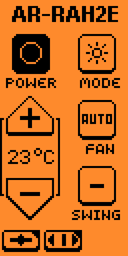

# Fujitsu AC Remote

Fujitsu air conditioner remote control for Flipper Zero. Forked from [achistyakov/flipperzero-mitsubishi-ac-remote](https://github.com/achistyakov/flipperzero-mitsubishi-ac-remote).




Fujitsu ships several incompatible remote encodings, so the app asks which
remote you are replacing before showing the keypad. Press `Back` on the keypad
to return to the list and switch.

> [!WARNING]
> Picking the wrong remote type can lock the A/C up, requiring it to be
> physically powered off to recover. If you are unsure, start with `AR-RAH2E`.

## Supported remotes

| Listed as | Also covers |
| --- | --- |
| `AR-RAH2E` | AR-RAH2U, AR-RAC1E, AR-RAE1E, AR-RCE1E, AR-REG1U, AR-RCL1E |
| `AR-DB1` | AR-DL10, AR-JW17, AR-JW19 |
| `AR-REB1E` | AR-REB4E, AR-RAH1U |
| `AR-JW2` | AR-DL3 |
| `AR-RY4` | |
| `AR-REW4E` | AR-REW1E |

## Controls

The keypad mirrors the physical remote. Every button maps to a command
IRremoteESP8266 implements; nothing else is invented.

| Panel | On the remote | Sends |
| --- | --- | --- |
| Power | START/STOP | Turn on / turn off |
| Mode | MASTER CONTROL | Auto, Cool, Dry, Fan, Heat |
| Temp +/- | SET TEMP. | 16-30 °C |
| Fan | FAN CONTROL | Auto, High, Medium, Low, Quiet |
| Swing | SWING | Stop, Up/down, Left/right, Both |
| Vane up/down | ⇕ SET | Steps the vertical vane one notch |
| Vane left/right | ⇔ SET | Steps the horizontal vane one notch |

Power is a real toggle: the button shows the current state, and it is the only
button that changes it. Every other button sends a "stay on" frame carrying the
new setting, so changing the mode or temperature does not switch the unit on,
exactly as the physical remote behaves.

A filled wedge in a button's top-right corner means it also responds to a long
press. Long-pressing either vane button starts or stops the swing on that axis.

The vane buttons step the vane one position per press and the indoor unit keeps
track of where it is — there is no absolute "go to angle N" code in the Fujitsu
protocol, and the physical remote works the same way. The app therefore cannot
show which position the vane is currently in.

Which buttons appear depends on the selected remote. `AR-DB1` and `AR-JW2`
carry no swing setting, so their Swing button is hidden and the vane is steered
entirely with the vane buttons. The horizontal vane button only appears on
`AR-RAH2E` and `AR-JW2`, the two families that accept the horizontal commands.

AIR CLEAN, COIL DRY, SLEEP and the timers are not implemented: IRremoteESP8266
does not model them for this remote family.

The mode, temperature, fan, swing, power state and remote type are saved
between sessions.

## Protocol

The encoder in `lib/hvac_fujitsu` is a port of
[IRremoteESP8266](https://github.com/crankyoldgit/IRremoteESP8266)'s
`ir_Fujitsu`, which supports every known Fujitsu remote family. The frames it
produces were checked byte for byte against the expected states in that
project's `test/ir_Fujitsu_test.cpp`.

## Building

```shell
# Clone repository
git clone <this repository>
cd flipperzero-fujitsu-ac-remote

# Build the application
ufbt build

# Build and launch the application
ufbt launch
```

## Credits

Adapted from [flipperzero-mitsubishi-ac-remote](https://github.com/achistyakov/flipperzero-mitsubishi-ac-remote)
by Anton Chistyakov, which the app layout and panel view come from.
